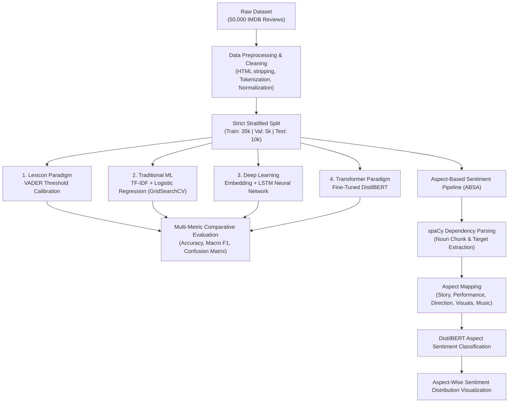

# 🎬 Multi-Paradigm Sentiment Analysis & Aspect-Based Opinion Mining

[](https://www.python.org/)
[](https://pytorch.org/)
[](https://huggingface.co/)
[](https://spacy.io/)
[](https://scikit-learn.org/)
[](#license)

A comprehensive comparative study and benchmarking across four historical NLP eras—ranging from **Lexicon-based rules** to **State-of-the-Art Transformers**—evaluated on **50,000 IMDB Movie Reviews**, accompanied by an advanced **Aspect-Based Sentiment Analysis (ABSA)** pipeline using syntactic dependency parsing.

---

## 📌 Project Overview

Understanding subjective sentiment across social platforms and multimedia reviews requires addressing complexities like nuanced vocabulary, sentence structures, and aspect-specific critiques.

This project delivers:
1. **Cross-Era Architectural Benchmarking**: A strict three-way split (Train 70% / Val 10% / Test 20%) benchmarking four distinct paradigm eras:
   - **Lexicon-Based**: VADER Sentiment Intensity Analyzer (with boundary threshold calibration).
   - **Traditional Machine Learning**: TF-IDF Vectorization + Tuned Logistic Regression via 5-Fold Stratified `GridSearchCV`.
   - **Deep Learning**: Word Embedding + Bi-directional / Recurrent LSTM Neural Network.
   - **Transformer Architecture**: Fine-Tuned `distilbert-base-uncased` with contextualized self-attention.
2. **Grammar & Dependency Opinion Mining**: Utilizing `spaCy` to extract opinion targets (nouns) and modifiers (adjectives) via grammatical dependencies (`amod`, `nsubj`).
3. **Aspect-Based Sentiment Analysis (ABSA)**: Automated extraction and sentiment attribution across 5 core cinematic dimensions:
   - 📖 **STORY** (`plot`, `story`, `script`, `narrative`, `screenplay`)
   - 🎭 **PERFORMANCE** (`acting`, `cast`, `actor`, `actress`, `performance`)
   - 🎬 **DIRECTION** (`direction`, `director`, `directing`)
   - 🎨 **VISUALS** (`cinematography`, `effects`, `cgi`, `visuals`)
   - 🎵 **MUSIC** (`music`, `soundtrack`, `score`, `sound`)

---

## 🏗️ System Architecture



---

## 📊 Experimental Results & Benchmarking

All models were evaluated on the exact same unseen **10,000 test reviews** to ensure scientific fairness and prevent data leakage:

| Paradigm Era | Architecture / Model | Test Accuracy | Macro F1-Score | Key Insights & Characteristics |
| :--- | :--- | :---: | :---: | :--- |
| **Lexicon-Based** | VADER (Threshold = 0.50) | **71.35%** | **0.7102** | Zero-shot rule engine; fast but struggles with subtle context and sarcasm. |
| **Deep Learning** | Embedding + LSTM Network | **87.34%** | **0.8732** | Models sequential flow and word sequences effectively. |
| **Transformer** | Fine-Tuned DistilBERT | **88.06%** | **0.8806** | Strong semantic comprehension with bi-directional self-attention mechanism. |
| **Traditional ML** | Tuned Logistic Regression + TF-IDF | **89.46%** | **0.8946** | Extremely strong performance on high-dimensional n-gram representations with minimal compute footprint. |

---

## 🔍 Aspect-Based Sentiment Analysis (ABSA) Pipeline

Beyond binary document-level classification, the ABSA pipeline breaks down user critiques into fine-grained dimensions:

1. **Dependency Relation Extraction**:
   - Direct Adjectival Modifiers (`amod`): e.g., *"stellar cinematography"* $\rightarrow$ Target: `cinematography`, Modifier: `stellar` (Positive).
   - Predicate Adjectives (`nsubj`): e.g., *"the script was disappointing"* $\rightarrow$ Target: `script`, Modifier: `disappointing` (Negative).
2. **Aspect Attribution & Profiling**:
   - Sentences are mapped to target aspects (`STORY`, `PERFORMANCE`, `DIRECTION`, `VISUALS`, `MUSIC`).
   - A fine-tuned sequence classification model determines polarity per aspect, rendering an intuitive distribution chart of positive vs. negative reception.

---

## 📁 Repository Structure

```text
├── Ass/
│   ├── Social_Media_Computing_Project_(1).ipynb   # End-to-end executable Jupyter Notebook
│   └── 2026 Assignment Instructions CDS6344.pdf   # Project background & specifications
├── .gitignore                                     # Excludes checkpoints, pycache, temporary files
└── README.md                                      # Comprehensive project documentation
```

---

## 🚀 Quick Start & How to Run

### 1. Prerequisites
Ensure you have Python 3.9+ installed with GPU acceleration (optional, recommended for DistilBERT and LSTM).

### 2. Environment Setup
Install the necessary dependencies:
```bash
pip install torch torchvision transformers datasets
pip install nltk spacy scikit-learn pandas numpy matplotlib seaborn kagglehub
python -m spacy download en_core_web_sm
```

### 3. Running the Notebook
You can run the notebook locally or upload it to **Google Colab**:
```bash
jupyter notebook "Ass/Social_Media_Computing_Project_(1).ipynb"
```

---

## 🛠️ Tech Stack
- **Languages & Frameworks**: Python, PyTorch, HuggingFace Transformers
- **NLP & Parsing**: NLTK, spaCy (`en_core_web_sm`), VADER
- **Machine Learning**: Scikit-learn (TF-IDF, Logistic Regression, GridSearchCV)
- **Data Visualization**: Matplotlib, Seaborn
